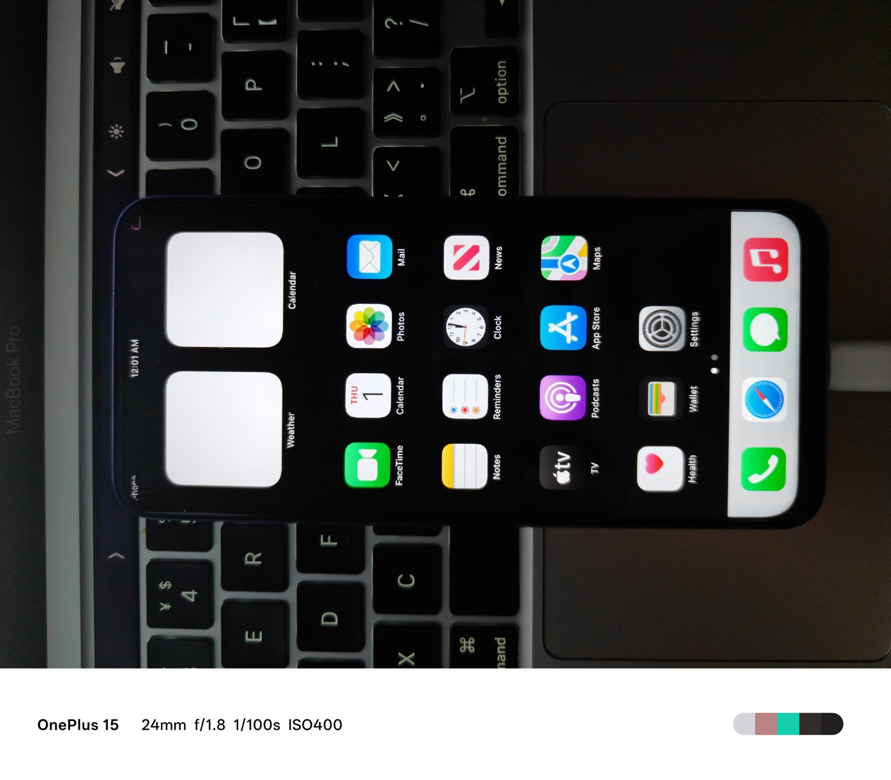

# iOS 16 在 MT6833（OPPO K9x / PGCM10）上的真机移植记录

> **v78 最新实机进展**：[固件已完整写入、读回校验并运行，收到A3/TP信息回复](docs/07-IRAM固件加载与活体握手打通.md)。剩真实报告与HID接入，桌面触摸尚未验收。
>
> **v77 写入进展**：[芯片写入/读回/原值恢复已验证，本机固件分块CRC已通过](docs/06-本机固件分块与可逆读写.md)。下一阶段为有界IRAM加载与活体握手，桌面触摸尚未验收。
>
> **v76 通信进展**：[GPIO SPI 已三次读取 PID 0x78071f05](docs/05-GPIO触摸身份打通.md)，引脚恢复检查通过。此前“MISO物理无信号/芯片不响应”的结论已被反证；固件运行与桌面触摸仍待验证。
>
> **2026-11-10 前一阶段触摸结论更正**：[二次核验与 ACK 修复](docs/04-触摸二次核验与ACK修复.md)。v69 的 ACK 探针只有一字节，旧的“硬件全绿 / MISO 物理无信号”结论证据不足。v70 已修探针；v73 大字显示已实机验证；v75 推进到 PID 读取事务后超时，触摸尚未修通。下文 v69 及以前的排除项保留为历史，不作为当前判定。

> 一台天玑 810 的 Android 手机，跑起了 Apple 的 XNU 内核和 iOS 16 用户态。
> 桌面、显示、三个实体按键可用；触摸没通。
>
> 这份仓库是整个过程的技术记录：每个版本改了什么、读数是什么、哪里卡住了、哪些路已经走死。
> 不是教程，是一份可验证的工程日志——所有结论都有实机读数或源码出处。

---

## 目录

- [结论](#结论)
- [硬件档案](#硬件档案)
- [引导链](#引导链)
- [三个阶段](#三个阶段)
- [三个「不修就永远不可能通」的 bug](#三个不修就永远不可能通的-bug)
- [已经排除的清单](#已经排除的清单别再试了)
- [版本时间线](#版本时间线)
- [如何构建](#如何构建)
- [如何刷写与回滚](#如何刷写与回滚)
- [仓库结构](#仓库结构)
- [还没做完的](#还没做完的)
- [参考](#参考)

---

## 结论

| 目标 | 状态 | 证据 |
|---|---|---|
| 进入桌面（SpringBoard） | **已达成** | `memory: ... (5 surfaces 17, ...)`，用户目视确认 |
| 显示 | **已达成** | `MiniIOMobileFramebuffer: 51 frames in 5008 ms`，1125×2436 软件合成 |
| 按键（电源 / 音量上 / 音量下） | **已达成** | `mt6833keys: HB up 1 down 1 power 2`，三键全部产生 HID 事件 |
| 触摸 | **未达成** | MISO 恒 `0x0`，芯片从不驱动 |



*2026-11-08 16:48，OPPO K9x 实机。状态栏、小组件、图标、Dock 全部正常——这是从 iPhone X 的
iOS 16.5 IPSW 里提取的用户态，跑在 MT6833 上。*

这不是模拟器，也不是套壳：真机从 LK 引导链直接跳进 XNU，跑的是从 iPhone X（iPhone10,3）
iOS 16.5 IPSW 里提取的用户态。安全模型全部关闭（AMFI / Sandbox 放开，Keychain 是桩）。

## 硬件档案

| 项 | 值 | 来源 |
|---|---|---|
| 机型 | OPPO PGCM10 / OPD2A0（K9x，项目代号 210A0，产品名 ossi） | `ro.product.*` |
| SoC | MT6833（天玑 810），board `k6833v1_64` | `ro.board.platform` |
| CPU | **2×Cortex-A76（0xd0b）@2.4 GHz + 6×Cortex-A55（0xd05）@2.0 GHz** | `/proc/cpuinfo` |
| GPU | Mali-G57 MC2 r0p1 | `/sys/class/misc/mali0/device/gpuinfo` |
| 内存 | 7,824,700 kB 可用 | `/proc/meminfo` |
| 存储 | **UFS 2.2**，控制器 `11270000.ufshci` | dmesg |
| 系统 | Android 12（SP1A.210812.016），内核 4.14.186 | `uname -a` |
| 屏幕 | 1080×2400，60 Hz，**ILI7807S TDDI**（Tianma），**C-PHY DSI 3-lane 视频模式** | dmesg + live DT |
| 面板时序 | 60 Hz：clock 253604 kHz，h 1080/26/4/65，v 2400/1260/4/20 | OPPO 面板驱动 |
| 触摸 | **ILITEK ILI7807S**，SPI4 `11018000`，CS0，IRQ GPIO14 / RST GPIO15 | live DT + dmesg |
| 触摸坐标 | max_x 4320 / max_y 9600（面板像素的 4 倍） | `/proc/bus/input` |
| 按键 | KPD `10010000`，音量上 GPIO1 / 音量下 GPIO80；电源键在 MT6359（`TOPSTATUS` bit1） | live DT |
| PMIC | MT6359 + MT6315，`pwrap @ 10026000` | live DT |
| 帧缓冲 | LK 交接 `0x76720000`，stride 4352，a8r8g8b8，1088×2400 | `mblock-18-framebuffer` |
| boot 分区 | **32 MiB**，Android header **v2**，page 2048 | 解包实测 |
| 加载地址 | kernel `0x40080000` / ramdisk `0x51100000` / tags `0x47c80000` | 解包实测 |
| 引导状态 | 已解锁（`flash.locked=0`，`verifiedbootstate=orange`），AVB 1.2 | `ro.boot.*` |

## 引导链

```
MTK BootROM → preloader（mmcblk0boot0）→ LK → boot.img
                                          │
                                          └─ mtkloader（裸机 arm64，链接到 0x40080000）
                                               ├─ 读 LK 留下的 live FDT
                                               ├─ 构造 Apple DeviceTree（ADT）+ boot-args
                                               ├─ 面板初始化：42 条 DCS over DSI VM_CMD
                                               ├─ 加载 XNU Mach-O + ramdisk + iOS 系统镜像
                                               └─ jump_to_kernel
                                                    │
                                                    └─ XNU 8796.121.2
                                                         ├─ MTK UFS 驱动（只读）
                                                         ├─ APFS 根（xnusys 分区）
                                                         ├─ MiniIOMobileFramebuffer（写 LK 的 framebuffer）
                                                         └─ launchd → backboardd → SpringBoard
```

`boot.img` 的 kernel 段其实是三样东西拼起来再 gzip：

```
mtkloader.bin  +  padding 到 0x40000  +  Android 原厂 Image  +  XNUP payload
```

中间那个原厂 Image 是给「回链」用的：loader 跑完（或出错）时把控制权交回 Android 内核。

每次跑 300 秒（`loader_return_after=300`）后交还控制权，loader 把 XNU 日志打在屏幕上停留 240 秒，
然后 warm reset 回 Android。**一轮完整周期约 602 秒**，三轮实测都是这个数（602 / 602 / 601）。

## 三个阶段

### 阶段一：进桌面（2026-11-05 → 11-06）

最初的诊断镜像用 `fastboot boot` 起不来，改用 `fastboot flash boot` 后触发 LK 循环重启。
离线分析 LK、确认 AVB 结构、修正 boot 分区尾部之后，v17 在 11-06 19:07 第一次进入 SpringBoard。

关键教训：**`fastboot boot` 在这台机器上不可用**，实测连原厂镜像都会让 LK 崩（`bootreason=lk_crash`）。

### 阶段二：按键与帧率（11-06 → 11-07）

- 音量下：GPIO80 / EINT80，低有效
- 电源键：MT6359 `TOPSTATUS(0x2a)` bit1 `PWRKEY_DEB`，低有效
- **音量上：不是 GPIO1**。`kpd.c` 在 `kpd_sw_rstkey == KEY_VOLUMEUP` 时置 `homekey_as_vol_up`，
  音量上改由 **PMIC homekey** 产生（`TOPSTATUS` **bit3** `PMIC_HOMEKEY_DEB`）。这一条前序会话误判了两天。
- 帧率：SPI 超时修掉后从 10 fps 回到 21 fps（本次复测是 10 fps，见 [还没做完的](#还没做完的)）

### 阶段三：触摸攻坚（11-07 → 11-08）

见下节。这一阶段没有成功，但把问题从「芯片不应答」重新定义成了「链路上没有信号」。

## 三个「不修就永远不可能通」的 bug

前序两天的所有 SPI 调试——四相位探针、5312 次 IRAM 写入、pinmux 验证、IES 检查、ICE 协议——
**全部建立在这三个错误之上**。任意一个都足以让芯片一声不吭。

### 1. SPI 模式 3，Android 是模式 0

```c
/* mtkspi.h  spi_xfer()  —— 错的 */
wr32(SPI2_BASE + SPI_CMD, SPI_CMD_CPHA | SPI_CMD_CPOL | SPI_CMD_TXMSBF | SPI_CMD_RXMSBF);

/* 对的 */
wr32(SPI2_BASE + SPI_CMD, SPI_CMD_TXMSBF | SPI_CMD_RXMSBF);   /* CPOL=CPHA=0 */
```

Android 侧证据：

```
[TP]ILITEK: ili_core_spi_setup: name = tp_noflash, bus_num = 4, cs = 0, mode = 0, speed = 10000000
```

### 2. SPI2 基址，而触摸在 SPI4

```c
#define SPI2_BASE  0x11012000ULL   /* 错：SPI2 */
#define SPI2_BASE  0x11018000ULL   /* 对：SPI4，DT spi4@11018000 */
```

**从 v19 到 v66，所有 SPI 读写在跟一个空控制器说话。** MISO 读回 0 不是芯片不应答，是那条总线上根本没芯片。

引脚同样是 MT6768 的：`25/26/27/28` → 应为 `12、13、97、98、99、100`。
Android 实测 `GPIO_MODE1 = 0x00220007`、`GPIO_MODE12 = 0x11122221`。

### 3. SPI 时钟 mux 写错了寄存器

`drivers/clk/mediatek/clk-mt6833.c` 第 1232 行：

```c
MUX_CLR_SET_UPD(CLK_TOP_SPI_SEL, "spi_sel", spi_parents,
                CLK_CFG_6, CLK_CFG_6_SET, CLK_CFG_6_CLR,
                16 /* lsb */, 2 /* width */,
                INV_BIT, CLK_CFG_UPDATE, TOP_MUX_SPI_SHIFT /* = 26 */);

static const char * const spi_parents[] = {
    "tck_26m_mx9_ck",   /* 索引 0，26 MHz，正是要的 */
    "mainpll_d5_d4", ...
};
```

而 loader 写的是：

```c
#define CLK_CFG_2_CLR   0x68
#define SPI_SEL_FIELD   (3u << 24)
#define SPI_SEL_PDN     (1u << 31)
wr32(TOPCKGEN_BASE + CLK_CFG_2_CLR, SPI_SEL_FIELD | SPI_SEL_PDN);
```

**寄存器错（CLK_CFG_2 不是 CLK_CFG_6）、位错（24 不是 16）、还多写了一个不存在的 bit31。**
结果是 SPI 时钟源从来没被选择过，顺手还清掉了 CLK_CFG_2 里另一个无关时钟的字段。

正确写法：

```c
wr32(TOPCKGEN_BASE + 0x078, 3u << 16);   /* CLK_CFG_6_CLR */
wr32(TOPCKGEN_BASE + 0x074, 0u << 16);   /* CLK_CFG_6_SET：父时钟 0 = 26 MHz */
wr32(TOPCKGEN_BASE + 0x004, 1u << 26);   /* CLK_CFG_UPDATE：提交 */
```

### 三个都修好之后

```
ilitek: 0x82 -> 0x0  not ACK
ilitek: MODE1 0x220007 MODE12 0x11122221
ilitek: spi4 CMD 0x3000 STA0 0x7 CFG1 PAD 0x0
```

| 项 | 读数 | Android | |
|---|---|---|---|
| `GPIO_MODE1` | `0x00220007` | `0x00220007` | 一致 |
| `GPIO_MODE12` | `0x11122221` | `0x11122221` | 一致 |
| `SPI4 CMD` | `0x3000` | TXMSBF\|RXMSBF | 模式 0 正确 |
| `STA0` | `0x7` | bit0 DONE = 1 | 传输完成 |
| **MISO** | **`0x0`** | 期望 `0xA3` | **仍为 0** |

引脚、控制器、时钟全对了，线上就是没信号。

## 已经排除的清单（别再试了）

| 假设 | 怎么排除的 |
|---|---|
| SPI 控制器超时 / FIFO 分段 | `STA0` DONE 置位，`XFER` 成功率 99.4% |
| SPI 模式（CPOL/CPHA） | 改为模式 0 后无变化，但这是**必须改对**的前提 |
| 引脚复用 | `MODE1`/`MODE12` 读数与 Android 逐位一致 |
| IES（输入使能） | 全开，读数与 Android 一致 |
| pad-select | `SPI_PAD_SEL = 0`，未验证但先按 DT 来 |
| 触摸复位 GPIO15 | 已按 Android 的 `ili_tp_reset()` 时序拉过（高1ms→低5ms→高10ms） |
| 供电轨 | Android 驱动自己都说 `vcc_1v8`/`vdd_2v8` **找不到 regulator，用 dummy** → 硬件常开，不是变量 |
| 面板 DSI 初始化 | 42 条 DCS 已从 loader 发出，`INTSTA 0x7b2`（VM_CMD_DONE 置位） |
| 芯片是否上电 | Android 复位后 16 ms 就读到 `PID = 78071f`，说明它一直是活的 |
| 固件是否需要重灌 | 需要。IRAM 里的固件每次复位即丢，必须由 host 重灌 358,969 字节 |

## 版本时间线

| 版本 | 改动 | 结果 |
|---|---|---|
| v1 | 首个裸机诊断包 | `fastboot boot` 失败；flash 后 LK 循环重启 |
| v17 | 修正 AVB 尾部 | **首次进 SpringBoard**（11-06 19:07） |
| v18 | `loader_return_after=120` | 自动回 Android，不再需要断电 |
| v33–v39 | 三个按键 + SPI 探针 | 按键全通；MISO 恒 0 |
| v43 | ACK 门控 host-download | 21 fps，但门控判据是 MOSI 回环，形同虚设 |
| v60–v61 | 首次在 loader 里发 DSI | **循环重启**——打包脚本覆盖了 blob 头 0x28/0x30 |
| v62 | 修好打包 + 42 条 DCS | 正常进桌面，**5 surfaces** |
| v64b | 加触摸复位 GPIO15 | `RESET (GPIO15) done`，仍无 ACK |
| v66 | SPI 模式 3 → 0 | 仍 0 |
| v67 | SPI2 → SPI4 + 正确引脚 | 仍 0；且 loader 起不来（引脚冲突） |
| v68 | 加寄存器回读 | 拿到 MODE1/MODE12/CMD/STA0 实测值 |
| **v69** | **修 SPI 时钟 mux** | 引脚/控制器全对，**MISO 仍 0** |

## 如何构建

需要：XNU 源码树（xnu-8796.121.2）、`clang`、`ld.lld`、`python3`、`mkbootimg`、`avbtool`。

```sh
# 1. 编译 loader
bash mtk/loader/build.sh -DXNU_WDT_SECONDS=0 -DMENU_DEFAULT_XNU=1 \
     -DXNU_FLAT_BOOT=1 -DTOUCH_RESET_GPIO

# 2. 编译 XNU（需要 Apple 的开源 xnu + 补丁系列）
make kernel JOBS=8

# 3. 打 payload（XNU Mach-O + ramdisk）
python3 xnuloader/mkpayload.py -o payload.bin kernel=.../mach.development.bcm2837 ramdisk=ramdisk.bin

# 4. 打进 boot.img（保留原厂 AVB 尾部）
python3 build_v3.py stock-boot.img mtkloader.bin payload.bin out.img
```

**第 4 步有个坑**：`build_v3.py` 是在 loader 就位**之后**才写 blob 头里的三个字段的——

| 偏移 | 含义 | 值（本机） |
|---|---|---|
| `0x10` | arm64 Image `image_size` | `0x4b00000` |
| `0x28` | 原厂 Android Image 长度 | `0x31ab000` |
| `0x30` | XNUP payload 偏移 | `0x31eb000` |

直接替换 `mtkloader.bin` 而不恢复这三个字段，loader 会按「payload 在偏移 0」跳转，**无限重启**。
这个坑踩了两次（v60 / v61）。

## 如何刷写与回滚

```sh
# 刷
adb reboot bootloader
fastboot flash boot out.img
fastboot reboot

# 回 Android（任何时候）
adb reboot bootloader
fastboot flash boot stock-boot.img
fastboot reboot
```

**不要用 `fastboot boot`**——实测原厂镜像也会让 LK 崩溃（`usb_read failed with status e00002ed`，
复位后 `ro.boot.bootreason=lk_crash`）。

**卡在循环重启时**：长按电源 15 秒强制关机 → 按住音量下 → 插 USB → 进 fastboot。

## 仓库结构

```
README.md                        本文件
AGENTS.md                        给继续做这件事的人 / AI 的工作约定
LICENSE                          MIT（vendor-reference 除外，GPL-2.0）

docs/
  00-复盘-从零到桌面.md            392 行完整技术记录，最详细的一份
  01-总体方案.md                   最初的 M0–M7 方案（大部分已被跨越）
  02-附录A-设备与样本实测.md        设备档案、分区表、IPSW 解剖原始数据
  03-iOS用户态可移植性分析.md       逐层可行性：iBoot / 内核 / 用户态 / 图形 / SEP

scripts/
  mkboot-mt6833.sh                打 header v2 boot.img（含 0x180000 shim、DT table、AVB）
  make_e1_image.py                 从已有镜像派生出「只改一个 boot-arg」的版本
  make_v60_image.py                只替换 loader、保留 blob 头字段的打包器
  verify_e1_image.py               逐字节验证两个镜像的差异范围
  dissect_ios.py                   IM4P 解包 + Mach-O / Apple FDT 探测
  decompress_kc.py                 LZFSE 解压 kernelcache / DeviceTree
  parse_boot_v2.py / parse_bootimg.py   Android boot 镜像解包
  gen_panel_seq.py                 从厂商面板驱动提取 44 步初始化表
  patch_*.py                       本次每个 bug 的最小改动脚本，可逐条复现
  android-touch-dump.sh            Android 侧只读 dump（宿主机跑）
  device-touch-dump.sh             同上，推到设备上跑，避免引号问题

include/
  panel-ili7807s-init.h            44 步面板初始化表（42 写 + 2 延时）

dts/
  mt6833-oplus-pgcm10-simplefb.dts simple-framebuffer 片段 + of_reserved_mem 补丁说明

logs/
  touch-dump2.txt                  Android 侧触摸链路实测（序列号已脱敏）
  touch-dump-android.txt           同上，第一版

vendor-reference/
  panel-oplus210a0_tianma_ili7807s_cphy_vdo.c   面板驱动原文（GPL-2.0）
```

## 还没做完的

### 触摸：MISO 恒 0

引脚、控制器、时钟全对，传输也确实完成，但 MISO 线上没有信号。只剩三种可能：

1. **`SPI_PAD_SEL` 取值不对** —— 控制器收发的不是这组 pad。没有 Android 侧对照数据（debugfs 挂不上）。
2. **芯片的 SPI 从机在等某个使能** —— 面板初始化之后可能还要一条厂商私有 DCS，
   或 TDDI 的 touch 部分有独立供电域没开。
3. **MISO 线上确实没信号** —— 需要量波形。

**下一步应该用逻辑分析仪量 SPI4 四根线。** 在 Android 下抓「复位后 16 ms 读 PID」那段波形，
和 iOS 侧对比。这能把三种可能一次分开，且不需要再刷机。

### 帧率 10 fps（曾达到 21 fps）

本次复测是 `51 frames in 5008 ms (10 a second)`，每帧在驱动里只花 8.6 ms——
剩下 90 ms 全在 CPU 软渲染。交付报告里提到 v38 曾到 21 fps。
可以试 `fb_threads=1 → 4`。**纯收益，零风险。**

### 其他

- `loader_return_after=300` 可以改成常驻，让它更像一台能用的机器
- Wi-Fi / 蓝牙 / 音频 / 相机 / 蜂窝：全部未做，也不需要做
- Mali-G57 的 Metal：可选，代价 6–12 人月，参考 [hakios-mt6768](https://github.com/oosexgang/hakios-mt6768)

## 参考

- [hakios-mt6768](https://github.com/oosexgang/hakios-mt6768) —— MTK Helio G85 + Mali-G52 跑 iOS 16.5 用户态，本项目的基座
- [hakios-xnu-kernel](https://github.com/oosexgang/hakios-xnu-kernel) —— 公共树，branch `mtk`
- [ios-sweet](https://github.com/0xSojalSec/ios-sweet) —— SM7150，工程日志最详细
- [oppo-source/android_kernel_oppo_mt6833](https://github.com/oppo-source/android_kernel_oppo_mt6833) —— 本机内核源码，
  branch `oppo/mt6833_s_12.1_oppo_k10_5g`（`VERSION=4 PATCHLEVEL=14 SUBLEVEL=186`，与本机一致）
- [Dodaskot/a22x-mainline](https://github.com/Dodaskot/a22x-mainline) —— 同 SoC 的 Linux 移植，C-PHY DSI 面板点亮可参考
- [Project Sandcastle 复盘](https://projectsandcastle.org/history) —— AIC / FIQ / 16K 页的一手材料

## 许可

本仓库的分析、脚本、文档：**MIT**。
`vendor-reference/` 下的文件来自 OPPO 开源内核，遵循 **GPL-2.0**，版权归 MediaTek / OPPO 所有。

**不含任何 Apple 二进制、不含设备固件。** 需要 iOS 用户态请自行从 Apple 的 IPSW 提取。
